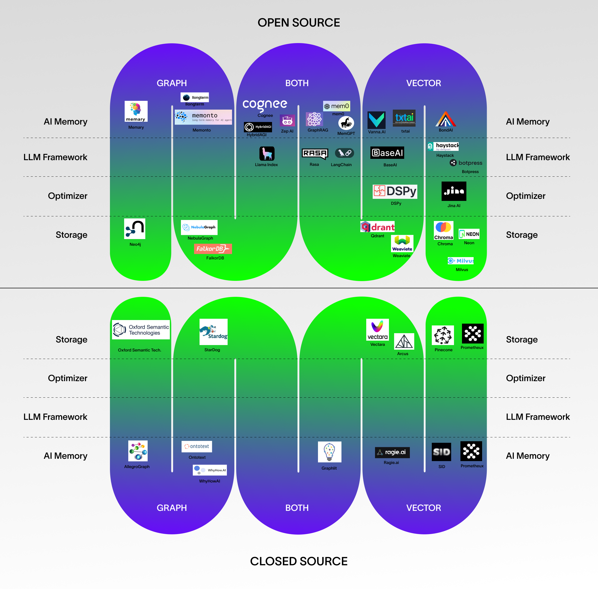

<h1 align="center"> Awesome AI Memory <p align="center"> <a href="https://discord.gg/tV7pr5XSj7" target="_blank">  </a> <a href="https://twitter.com/tricalt" target="_blank">  </a> </p> </h1> <h3 align="center"> Add <a href="https://github.com/topoteretes/cognee"> cognee</a> to your AI App </h3> <h5 align="center">🌟 </h5>


> A curated list of tools, frameworks, optimizers, and storage layers that give AI apps and agents memory.

[Check out Cognee – A semantic memory for AI Apps and Agents](https://github.com/topoteretes/cognee)

- **Browse examples in the [Cognee QuickStart](https://topoteretes.github.io/cognee/quickstart/)**
- **Contact us at [info@topoteretes.com](mailto:info@topoteretes.com) or join us on [Discord](https://discord.gg/m9KxxYWH)**
- **Follow us on [Twitter](https://twitter.com/tricalt)**

## Welcome to our curated list of AI memory tools
You can see the projects split across various dimensions
1. Open-source projects vs Closed-source projects and companies
2. Graph, Vector, or Both
3. Memory, Framework, Optimizer, or Storage


There might be many more companies we are not aware of. Your feedback and contributions are appreciated! ❤️

Have anything to add?
Please open a pull request

[Check out Cognee – A semantic memory for AI Apps and Agents](https://github.com/topoteretes/cognee)

- **Browse examples in the [Cognee QuickStart](https://topoteretes.github.io/cognee/quickstart/)**
- **Contact us at [info@topoteretes.com](mailto:info@topoteretes.com) or join us on [Discord](https://discord.gg/m9KxxYWH)**
- **Follow us on [Twitter](https://twitter.com/tricalt)**


| Name                          | URL                                      | Open / Close       | GitHub URL                                      | Category        | Storage       |
|-------------------------------|------------------------------------------|--------------------|-------------------------------------------------|-----------------|---------------|
| cognee                        | https://www.cognee.ai/                   | Managed, Open source | https://github.com/topoteretes/cognee         | Memory Tool     | Graph, Vector |
| mem0 (mem zero)               | https://mem0.ai/                         | Managed, Open source | https://github.com/mem0ai/mem0                  | Memory Tool     | Graph, Vector |
| MemClaw                       | https://memclaw.net/                     | Managed, Open source | https://github.com/caura-ai/caura-memclaw     | Memory Tool       | Graph, Vector |
| Zep AI                        | https://www.getzep.com/                  | Managed, Open source | https://github.com/getzep/zep                   | Memory Tool     | Graph, Vector |
| memonto                       |                                          | Open source        | https://github.com/shihanwan/memonto            | Memory Tool     | Graph         |
| Memary                        | https://finetune.dev/                    | Open source        | https://github.com/kingjulio8238/Memary         | Memory Tool     | Graph         |
| BaseAI (from Langbase) - Memory | https://langbase.com/docs/memory        | Managed, Open source | https://github.com/LangbaseInc/baseai           | Memory Tool     | Vector        |
| BondAI                        | https://bondai.dev/docs/agent-memory/    | Open source        | https://github.com/krohling/bondai              | Memory Tool     | Vector        |
| MemGPT (from Letta)           | https://memgpt.ai/                       | Managed, Open source | https://github.com/cpacker/MemGPT               | Memory Tool     | Graph, Vector |
| Statewave                     | https://statewave.dev/                   | Open source          | https://github.com/statewave-ai/statewave     | Memory Tool     | Graph, Vector |
| GraphRAG (from Microsoft)     | https://microsoft.github.io/graphrag/    | Open source        | https://github.com/microsoft/graphrag           | Memory Tool     | Graph, Vector |
| Llama index                   | https://www.llamaindex.ai/               | Managed, Open source | https://github.com/run-llama/llama_index        | LLM Framework   | Graph, Vector |
| Prometheus                    | https://prometheus.io/                   | Open source        | https://github.com/prometheus                   | Memory Tool     | Graph         |
| DSPy                          | https://dspy.ai/                         | Open source        | https://github.com/stanfordnlp/dspy             | Optimizer       | Vector        |
| Neo4j                         | https://neo4j.com/                       | Managed, Open source | https://github.com/neo4j                        | Storage         | Graph         |
| FalkorDB                      | https://www.falkordb.com/                | Open source          | https://github.com/FalkorDB/falkordb            | Storage         | Graph         |
| HybridAGI                     | https://synalinks.github.io/documentation/ | Open source        | https://github.com/SynaLinks/HybridAGI          | Memory Tool     | Graph, Vector |
| txtai                         | https://neuml.github.io/txtai/           | Open source        | https://github.com/neuml/txtai                  | Memory Tool     | Vector        |
| chroma                        | https://www.trychroma.com/               | Open source        | https://github.com/chroma-core/chroma           | Storage         | Vector        |
| LangChain                     | https://www.langchain.com/               | Open source        | https://github.com/langchain-ai/langchain       | LLM Framework   | Vector        |
| Weaviate                      | weaviate.io                              | Open source        | github.com/weaviate/weaviate                    | Storage         | Vector        |
| Milvus                        | milvus.io                                | Open source        | github.com/milvus-io/milvus                     | Storage         | Vector        |
| Qdrant                        | qdrant.tech                              | Open source        | github.com/qdrant/qdrant                        | Storage         | Vector        |
| Faiss                         | https://faiss.ai/                        | Open source        | github.com/facebookresearch/faiss               | Storage         | Vector        |
| Elasticsearch                 | https://www.elastic.co/elasticsearch     | Open source        | https://github.com/elastic/elasticsearch        | Storage         | Vector        |
| Jina AI                       | https://jina.ai/                         | Open source        | https://github.com/jina-ai                      | Optimizer       | Vector        |
| Haystack                      | https://haystack.deepset.ai/             | Open source        | https://github.com/deepset-ai                   | LLM Framework   | Vector        |
| Rasa                          | https://rasa.com/                        | Open source        | https://github.com/RasaHQ/                      | LLM Framework   | Graph, Vector |
| NebulaGraph                   | https://www.nebula-graph.io/             | Open source        | https://github.com/vesoft-inc/nebula            | Storage         | Graph         |
| Vanna.AI                          | https://vanna.ai/                       | Open source        | https://github.com/vanna-ai/vanna            | Memory Tool         | Vector        |
| Neon                          | https://neon.tech/                       | Open source        | https://github.com/neondatabase/neon            | Storage         | Vector        |
| WhyHowAI                      | https://www.whyhow.ai/                   | Closed             | https://github.com/whyhow-ai                    | Memory Tool     | Graph         |
| Graphlit                      | https://graphlit.com                     | Closed             |                                                 | Memory Tool     | Graph, Vector |
| ragie.ai                      | ragie.ai                                 | Closed             | https://github.com/ragieai                      | Memory Tool     | Vector        |
| Ontotext                      | https://www.ontotext.com/                | Closed             | https://github.com/Ontotext-AD                  | Memory Tool     | Graph         |
| SID                           | https://www.sid.ai/                      | Closed             |                                                 | Memory Tool     | Vector        |
| vectara                       | https://www.vectara.com/                 | Closed             |                                                 | Storage         | Vector        |
| arcus                         | arcus.co                                 | Closed             |                                                 | Storage         | Vector        |
| Oxford Semantic Technologies  | https://www.oxfordsemantic.tech/         | Closed             |                                                 | Storage         | Graph         |
| Prometheux                    | https://www.prometheux.co.uk/            | Closed             |                                                 | Memory Tool, Storage | Vector    |
| Pinecone                      | pinecone.io                              | Closed             |                                                 | Storage         | Vector        |
| AllegroGraph                  | https://allegrograph.com/                | Closed             |                                                 | Memory Tool     | Graph         |
| StarDog                       | https://www.stardog.com/                 | Closed             |                                                 | Storage         | Graph         |
| supabase                      | https://supabase.com/                    | Open source        | https://github.com/supabase                     | Storage         | Vector        |
| llongterm                      | https://www.llongterm.com/                    | Closed       |                      | Memory Tool         | Graph         |
Have anything to add? See the [Contributing](#contributing) section.

## Contents

- [How to use this list](#how-to-use-this-list)
- [Types of AI memory](#types-of-ai-memory)
- [Memory tools](#memory-tools)
- [LLM frameworks](#llm-frameworks)
- [Optimizers](#optimizers)
- [Storage](#storage)
- [Benchmarks & evaluation](#benchmarks--evaluation)
- [Contributing](#contributing)
- [Cite this list](#cite-this-list)

## How to use this list

Each project is tagged across three dimensions:

| Column | Values | Meaning |
|--------|--------|---------|
| **Open / Close** | Open source · Managed · Closed | Whether you can self-host, and whether a hosted offering exists |
| **Category** | Memory Tool · LLM Framework · Optimizer · Storage | Where it sits in the stack |
| **Storage** | Graph · Vector · Keyword · Graph, Vector | How it represents and retrieves memory |

- **Memory Tool** — purpose-built to give agents persistent, retrievable memory.
- **LLM Framework** — general agent/app frameworks that include a memory module.
- **Optimizer** — improves retrieval, prompts, or embeddings rather than storing memory directly.
- **Storage** — the underlying database or index (vector store, graph DB, or keyword index) a memory layer is built on.

## Types of AI memory
 
Most memory systems combine a few well-established kinds of memory:
 
- **Short-term (working) memory** — transient context held within the model's context window for a single task or conversation.
- **Long-term memory** — information persisted externally and retrieved across sessions. It's commonly broken down into:
  - **Episodic** — specific past events and interactions ("what happened").
  - **Semantic** — facts, preferences, and entities ("what is true").
  - **Procedural** — reusable workflows and skills ("how to do something").
Implementations differ mainly in how they store and retrieve this memory: **vector** search for semantic similarity, a **graph** for entities and relationships, or a **hybrid** of both (often with keyword/BM25 signals on top).

## Memory tools

| Name | Description | URL | Open / Close | GitHub URL | Category | Storage |
|------|-------------|-----|--------------|------------|----------|---------|
| cognee | Open-source AI memory platform for agents; builds a self-hosted knowledge graph with hybrid vector + graph retrieval via an ECL pipeline | https://www.cognee.ai/ | Managed, Open source | https://github.com/topoteretes/cognee | Memory Tool | Graph, Vector |
| mem0 (mem zero) | Self-improving memory layer for AI agents and assistants | https://mem0.ai/ | Managed, Open source | https://github.com/mem0ai/mem0 | Memory Tool | Graph, Vector |
| MemClaw | Governed, shared memory for multi-agent AI fleets (pgvector + graph + keyword) | https://memclaw.net/ | Managed, Open source | https://github.com/caura-ai/caura-memclaw | Memory Tool | Graph, Vector |
| Zep AI | Memory layer for AI agents built on a temporal knowledge graph | https://www.getzep.com/ | Managed, Open source | https://github.com/getzep/zep | Memory Tool | Graph, Vector |
| Mengram | Memory API with semantic, episodic, and procedural memory types | https://mengram.io/ | Managed, Open source | https://github.com/alibaizhanov/mengram | Memory Tool | Graph, Vector |
| memonto | Long-term agent memory mapped onto a user-defined ontology / knowledge graph | | Open source | https://github.com/shihanwan/memonto | Memory Tool | Graph |
| Memary | Open-source long-term memory for autonomous agents using a knowledge graph | https://finetune.dev/ | Open source | https://github.com/kingjulio8238/Memary | Memory Tool | Graph |
| BaseAI (from Langbase) - Memory | Memory module of Langbase's open-source BaseAI framework for serverless AI agents | https://langbase.com/docs/memory | Managed, Open source | https://github.com/LangbaseInc/baseai | Memory Tool | Vector |
| BondAI | Open-source AI agent framework with built-in vector memory | https://bondai.dev/docs/agent-memory/ | Open source | https://github.com/krohling/bondai | Memory Tool | Vector |
| MemGPT (from Letta) | LLM "operating system" that manages memory beyond the context window | https://memgpt.ai/ | Managed, Open source | https://github.com/cpacker/MemGPT | Memory Tool | Graph, Vector |
| GraphRAG (from Microsoft) | Graph-based RAG over knowledge graphs extracted by an LLM | https://microsoft.github.io/graphrag/ | Open source | https://github.com/microsoft/graphrag | Memory Tool | Graph, Vector |
| Prometheus | Open-source monitoring system and time-series database | https://prometheus.io/ | Open source | https://github.com/prometheus | Memory Tool | Graph |
| HybridAGI | Programmable neuro-symbolic agent framework with graph-based memory | https://synalinks.github.io/documentation/ | Open source | https://github.com/SynaLinks/HybridAGI | Memory Tool | Graph, Vector |
| txtai | All-in-one embeddings database for semantic search, LLM orchestration, and RAG | https://neuml.github.io/txtai/ | Open source | https://github.com/neuml/txtai | Memory Tool | Vector |
| Vanna.AI | Open-source text-to-SQL framework using RAG over your database schema | https://vanna.ai/ | Open source | https://github.com/vanna-ai/vanna | Memory Tool | Vector |
| MemClaw | Persistent, project-isolated memory for AI coding agents, with a web dashboard | https://memclaw.me | Open source | https://github.com/Felo-Inc/memclaw | Memory Tool | Vector |
| LWC | Local-first proactive memory CLI for AI coding agents; maintains a source-grounded SQLite Wiki with optional document-graph and CodeGraph projections | https://janyork.github.io/llm-wiki-cli/ | Open source | https://github.com/JanYork/llm-wiki-cli | Memory Tool | Graph |
| Basic Memory | Local-first knowledge base for AI conversations: plain Markdown notes form a semantic knowledge graph, served to assistants over MCP | https://basicmemory.com | Managed, Open source | https://github.com/basicmachines-co/basic-memory | Memory Tool | Graph |
| memsearch | Markdown-first semantic memory for AI agents (Zilliz): hybrid vector + keyword search over Markdown notes, backed by Milvus | https://zilliztech.github.io/memsearch/ | Open source | https://github.com/zilliztech/memsearch | Memory Tool | Vector |
| shodh-memory | Local, LLM-free memory for AI agents in a single offline Rust binary: knowledge graph with Hebbian learning, deterministic and auditable | https://github.com/varun29ankuS/shodh-memory | Open source | https://github.com/varun29ankuS/shodh-memory | Memory Tool | Graph, Vector |
| Remembra | Cross-agent session handoffs for coding agents (facts from git, a short brief for the next agent, a trail of every session) on a memory layer with entity extraction and hybrid recall | https://remembra.dev/ | Managed, Open source | https://github.com/remembra-ai/remembra | Memory Tool | Graph, Vector |
| OMEGA Memory | Persistent memory for AI coding agents | https://omegamax.co/ | Open source | https://github.com/omega-memory/omega-memory | Memory Tool | Vector |
| Hindsight (by Vectorize) | Open-source agent memory that learns from interactions; graph + vector retrieval | https://hindsight.vectorize.io | Open source | https://github.com/vectorize-io/hindsight | Memory Tool | Graph, Vector |
| Mnemory | Self-hosted, secure memory system for AI agents and assistants | | Open source | https://github.com/fpytloun/mnemory | Memory Tool | Vector |
| Screenpipe | Searchable local screen and audio history exposed to AI assistants through a local API and MCP server | https://screenpipe.com/ | Source-available | https://github.com/screenpipe/screenpipe | Memory Tool | Keyword, Vector |
| PMB (Personal Memory Brain) | Local-first persistent memory for AI coding agents over MCP; captures decisions, lessons and facts as you work and injects the relevant ones back via lifecycle hooks. Hybrid BM25 + vector + entity-graph retrieval, fully offline, no API keys | https://oleksiijko.github.io/pmb | Open source | https://github.com/oleksiijko/pmb | Memory Tool | Graph, Vector |
| Inite Brain | Open-source memory layer for LLM agents: bitemporal knowledge graph with facts/episodes/procedural tiers, hybrid retrieval, multi-hop planner, GDPR forget; LoCoMo-benchmarked | https://brain.inite.ai | Managed, Open source | https://github.com/inite-ai/inite-brain-service | Memory Tool | Graph, Vector |
| MFS | Context harness for AI agents (Zilliz): code, memory, docs and data sources in one searchable, file-like interface, powered by Milvus | https://zilliztech.github.io/mfs/ | Open source | https://github.com/zilliztech/mfs | Memory Tool | Vector |
| Off Grid AI Desktop | Open-source (AGPL-3.0) macOS app with on-device personal memory and RAG search over your own data, running fully local via llama.cpp; part of a local-first AI suite (chat, image gen, dictation) | https://getoffgridai.co/desktop | Open source | https://github.com/off-grid-ai/off-grid-ai-desktop | Memory Tool | Vector |
| Data Olympus | Governed project memory for AI coding agents: reviewed promotion, validity windows, supersession-aware retrieval, and MCP access to in-force knowledge | | Open source | https://github.com/knaisoma/data-olympus | Memory Tool | Graph, Vector |
| Engrava | Embedded memory database for AI agents: typed knowledge graph, hybrid search (vector + full-text + recency + priority + graph), and a tamper-evident SHA-256 journal of every write, in SQLite; no server, no LLM in the memory layer | https://engrava.ai | Open source | https://github.com/sovantica/engrava | Memory Tool | Graph, Vector, Keyword |
| GoodMemory | Local-first, auditable memory for AI agents and coding hosts, with SQLite persistence, embedding-free recall by default, optional vectors, and governed writeback | https://www.npmjs.com/package/goodmemory | Open source | https://github.com/hjqcan/GoodMemory | Memory Tool | Keyword, Vector |
| Lians | Open-source bitemporal memory for agents with deterministic supersession, point-in-time recall, and tamper-evident audit history | https://www.lians.ai/ | Open source | https://github.com/Lians-ai/Lians | Memory Tool | Vector |
| Talamus | Local-first, source-grounded memory for AI agents using inspectable Markdown, SQLite/FTS5 retrieval, citations, and bitemporal history | https://ampres-ai.github.io/talamus/ | Open source | https://github.com/ampres-ai/talamus | Memory Tool | Keyword |
| kgai | Local-first immutable knowledge graph of engineering decisions for AI coding agents; auto-captured, recalled before edits, superseded not overwritten | https://kgai.dev | Open source | https://github.com/kgaidev/kgai | Memory Tool | Graph |
| Compartment | Fully offline, encrypted-at-rest vector memory for AI agents; RAM-resident hybrid vector + keyword search, exposed as an MCP server or Python/CLI library | | Open source | https://github.com/MaxFreedomPollard/Compartment | Memory Tool | Vector |
| kannaka-memory | Wave-interference ("holographic resonance") memory for AI agents: memories as wavefronts in a high-dimensional tensor field, recall as a single tensor product, interference-based forgetting, dream-style consolidation and NATS multi-agent sync; Rust, single static binary | | Open source | https://github.com/NickFlach/kannaka-memory | Memory Tool | Vector |
| RE-call | Trustworthy memory retrieval for AI agents, backed by Postgres plus pgvector, with provenance, trust verdicts, tenant isolation, and explicit abstention when memory cannot support an answer | https://github.com/GiulioDER/RE-call | Open source | https://github.com/GiulioDER/RE-call | Memory Tool | Vector |
| Engraphy | Self-hosted typed memory graph for AI agents, spoken over MCP; writes deduplicate against existing memory before they land, retrieval fuses vector and full-text search with typed-edge traversal | https://engraphy.tech | Source-available (BSL 1.1) | https://github.com/devon-clarkk/engraphy | Memory Tool | Graph, Vector |
| inspeximus | Self-correcting agent memory: a correction retires the old value by key, revert() undoes the correction on command, and every write leaves a verifiable receipt. No LLM in the loop | https://dancenitra.github.io/inspeximus/ | Open source | https://github.com/DanceNitra/inspeximus | Memory Tool | Vector |
| pond | Lossless archive of AI agent sessions across twelve coding-agent clients; keeps whole sessions in a local directory or your own S3 bucket on Lance, with BM25 keyword retrieval by default and optional embeddings, served over CLI, MCP, HTTP, and read-only SQL | https://pond.locker | Open source | https://github.com/tenequm/pond | Memory Tool, Storage | Keyword, Vector |
| Unlimited Context | Local-first context engine that keeps a billion-token encoded pool on disk and pages the relevant slices into the model's resident window | https://pypi.org/project/aether-context/ | Open source | https://github.com/AetherAI3/Unlimited-Context-LLM | Memory Tool | Vector |
| Mnemoverse | Hosted memory for AI agents over MCP; ratings on recalled memories re-rank what comes back next, and shared rooms let several agents use one memory | https://mnemoverse.com/ | Managed | https://github.com/mnemoverse/mcp-memory-server | Memory Tool | Graph |
| NexusMem | Local-first long-term memory for coding agents; indexes Git history, shell commands with exit codes, and project documentation | https://nexus-mem.vercel.app | Open source | https://github.com/yaminbkk/NexusMem | Memory Tool | Vector |
| Mnemosyne OS | Desktop memory that stays on the user's machine: vaults per life domain, hybrid retrieval (BM25 fused with vectors by RRF), and a governed door where the human decides which vaults a model is allowed to read | https://mnemosyne-os.io | Open core | https://github.com/Mnemosyne-OS/Mnemosyne-Neural-OS | Memory Tool | Vector |
| WhyHowAI | Knowledge-graph tooling for structuring RAG and agent memory | https://www.whyhow.ai/ | Closed | https://github.com/whyhow-ai | Memory Tool | Graph |
| Graphlit | Managed knowledge API for content ingestion, RAG, and agents | https://graphlit.com | Closed | | Memory Tool | Graph, Vector |
| ragie.ai | Managed RAG-as-a-service for ingesting and retrieving documents | https://ragie.ai | Closed | https://github.com/ragieai | Memory Tool | Vector |
| Ontotext | Enterprise knowledge-graph platform (GraphDB) for RDF and semantic data | https://www.ontotext.com/ | Closed | https://github.com/Ontotext-AD | Memory Tool | Graph |
| SID | | https://www.sid.ai/ | Closed | | Memory Tool | Vector |
| Prometheux | Explainable reasoning / ontology engine over large knowledge graphs (Vadalog) | https://www.prometheux.co.uk/ | Closed | | Memory Tool, Storage | Vector |
| AllegroGraph | Graph database supporting RDF, knowledge graphs, and vectors | https://allegrograph.com/ | Closed | | Memory Tool | Graph |
| llongterm | | https://www.llongterm.com/ | Closed | | Memory Tool | Graph |
| Alchemyst AI | Shared, traceable context and persistent memory layer for AI agents over company knowledge | https://getalchemystai.com/ | Closed | | Memory Tool, Storage | Graph, Vector |
| Remio | Personal AI assistant that captures web pages, meetings, emails and files into searchable knowledge and context-aware answers | https://remio.ai/ | Closed | | Memory Tool | Vector |
| MemoryPlugin | Long-term memory shared across 21+ AI chat tools and MCP clients via browser extension, MCP server, and API; imports ChatGPT, Claude, and Gemini chat history | https://www.memoryplugin.com/ | Closed | https://github.com/memoryplugin/mcp-server | Memory Tool | Vector |

## LLM frameworks

| Name | Description | URL | Open / Close | GitHub URL | Category | Storage |
|------|-------------|-----|--------------|------------|----------|---------|
| Llama index | Data framework for connecting LLMs to your data (RAG) | https://www.llamaindex.ai/ | Managed, Open source | https://github.com/run-llama/llama_index | LLM Framework | Graph, Vector |
| LangChain | Framework for building LLM applications and agents | https://www.langchain.com/ | Open source | https://github.com/langchain-ai/langchain | LLM Framework | Vector |
| Haystack | Open-source framework (deepset) for RAG and search pipelines | https://haystack.deepset.ai/ | Open source | https://github.com/deepset-ai | LLM Framework | Vector |
| PraisonAI | Multi-agent framework for building and orchestrating AI agents | https://docs.praison.ai/ | Open source | https://github.com/MervinPraison/PraisonAI | LLM Framework | Graph, Vector |
| Rasa | Open-source framework for conversational assistants | https://rasa.com/ | Open source | https://github.com/RasaHQ/ | LLM Framework | Graph, Vector |
| Autohand Code CLI | Open-source terminal coding agent with built-in persistent memory; 15+ model providers and local models | https://www.autohand.ai/code/ | Open source | https://github.com/autohandai/code-cli | LLM Framework | Vector |

## Optimizers

| Name | Description | URL | Open / Close | GitHub URL | Category | Storage |
|------|-------------|-----|--------------|------------|----------|---------|
| DSPy | Framework for programming and optimizing LLM prompts and pipelines (Stanford NLP) | https://dspy.ai/ | Open source | https://github.com/stanfordnlp/dspy | Optimizer | Vector |
| Jina AI | Multimodal AI framework for neural search and embeddings | https://jina.ai/ | Open source | https://github.com/jina-ai | Optimizer | Vector |

## Storage

| Name | Description | URL | Open / Close | GitHub URL | Category | Storage |
|------|-------------|-----|--------------|------------|----------|---------|
| Neo4j | Graph database | https://neo4j.com/ | Managed, Open source | https://github.com/neo4j | Storage | Graph |
| FalkorDB | Low-latency graph database for GraphRAG and AI workloads | https://www.falkordb.com/ | Open source | https://github.com/FalkorDB/falkordb | Storage | Graph |
| chroma | Open-source embedding (vector) database | https://www.trychroma.com/ | Open source | https://github.com/chroma-core/chroma | Storage | Vector |
| Weaviate | Open-source vector database | https://weaviate.io | Open source | https://github.com/weaviate/weaviate | Storage | Vector |
| Milvus | Open-source vector database | https://milvus.io | Open source | https://github.com/milvus-io/milvus | Storage | Vector |
| Qdrant | Open-source vector database / similarity search engine | https://qdrant.tech | Open source | https://github.com/qdrant/qdrant | Storage | Vector |
| Faiss | Library for efficient similarity search of dense vectors (Meta) | https://faiss.ai/ | Open source | https://github.com/facebookresearch/faiss | Storage | Vector |
| Elasticsearch | Search and analytics engine with vector search | https://www.elastic.co/elasticsearch | Open source | https://github.com/elastic/elasticsearch | Storage | Vector |
| NebulaGraph | Distributed open-source graph database | https://www.nebula-graph.io/ | Open source | https://github.com/vesoft-inc/nebula | Storage | Graph |
| Neon | Serverless Postgres (supports pgvector for embeddings) | https://neon.tech/ | Open source | https://github.com/neondatabase/neon | Storage | Vector |
| vectara | Managed RAG / retrieval platform | https://www.vectara.com/ | Closed | | Storage | Vector |
| arcus | | https://arcus.co | Closed | | Storage | Vector |
| Oxford Semantic Technologies | RDFox in-memory knowledge graph and reasoning engine | https://www.oxfordsemantic.tech/ | Closed | | Storage | Graph |
| Pinecone | Managed vector database | https://pinecone.io | Closed | | Storage | Vector |
| StarDog | Enterprise knowledge graph platform | https://www.stardog.com/ | Closed | | Storage | Graph |
| supabase | Open-source Postgres backend (supports pgvector for embeddings) | https://supabase.com/ | Open source | https://github.com/supabase | Storage | Vector |

## Benchmarks & evaluation
 
Common benchmarks used to compare AI memory systems on long-term recall and reasoning:
 
| Benchmark | What it measures | Link |
|-----------|------------------|------|
| ATM-Bench | First benchmark for multimodal, multi-source personalized referential memory QA over ~4 years of privacy-preserving personal records (emails, images, videos); queries require resolving personal references, multi-evidence reasoning, and handling conflicting evidence | [arxiv.org/abs/2603.01990](https://arxiv.org/abs/2603.01990) · [atmbench.github.io](https://atmbench.github.io/) · [atmbench/atmbench.github.io](https://github.com/atmbench/atmbench.github.io) |
| LoCoMo | Very long-term conversational memory (QA, event summarization, multimodal dialogue) over ~300-turn, multi-session conversations | [arxiv.org/abs/2402.17753](https://arxiv.org/abs/2402.17753) · [snap-research/locomo](https://github.com/snap-research/locomo) |
| LongMemEval | Long-term interactive memory across five abilities: information extraction, multi-session reasoning, temporal reasoning, knowledge updates, and abstention | [arxiv.org/abs/2410.10813](https://arxiv.org/abs/2410.10813) |
 
Memory tools often report scores on these (and on additional benchmarks such as ConvoMem and BEAM) — see each project's own README for current numbers.

## Contributing

There might be many more companies and projects we aren't aware of. Your feedback and contributions are appreciated! ❤️

To add a project, please open a pull request including its name, URL, source model (Open source / Managed / Closed), GitHub URL (if any), category, and storage model (Graph / Vector / Keyword / Graph, Vector).

## Cite this list
 
If this list is useful for your work, please cite it:
 
```bibtex
@misc{awesome-ai-memory,
  title        = {Awesome AI Memory},
  author       = {topoteretes},
  year         = {2026},
  howpublished = {\url{https://github.com/topoteretes/awesome-ai-memory}}
}
```
